<p align="center">
  
</p>

<h1 align="center">Manga Cleaner</h1>

<p align="center">
  <strong>Remove Japanese text from manga and webtoon pages, locally.</strong>
</p>

<div align="center">

[](https://cleaner.komiq.cc)
[](https://cleaner.komiq.cc)
[](LICENSE)
[](https://ko-fi.com/komiq)

[](https://cleaner.komiq.cc)
[](https://cleaner.komiq.cc)
[](#install)
[](https://v2.tauri.app/)
[](https://svelte.dev/)
[](https://www.rust-lang.org/)
[](https://onnxruntime.ai/)

</div>

Manga Cleaner is a standalone desktop app. It detects speech bubbles and free text, keeps only the Japanese, fits masks at native resolution, and cleans each region with the lightest engine that can do the job. Pixels outside an edited region stay bit-identical to the source. Colour mode, bit depth, embedded ICC profile and metadata are carried through to export.

**Private by default.** Everything runs on your machine: no account, no upload, no Python. An optional cloud GPU on your own Modal or Beam account stays off until you set it up. Every cloud render is confirmed first, and only a crop around the region is sent.

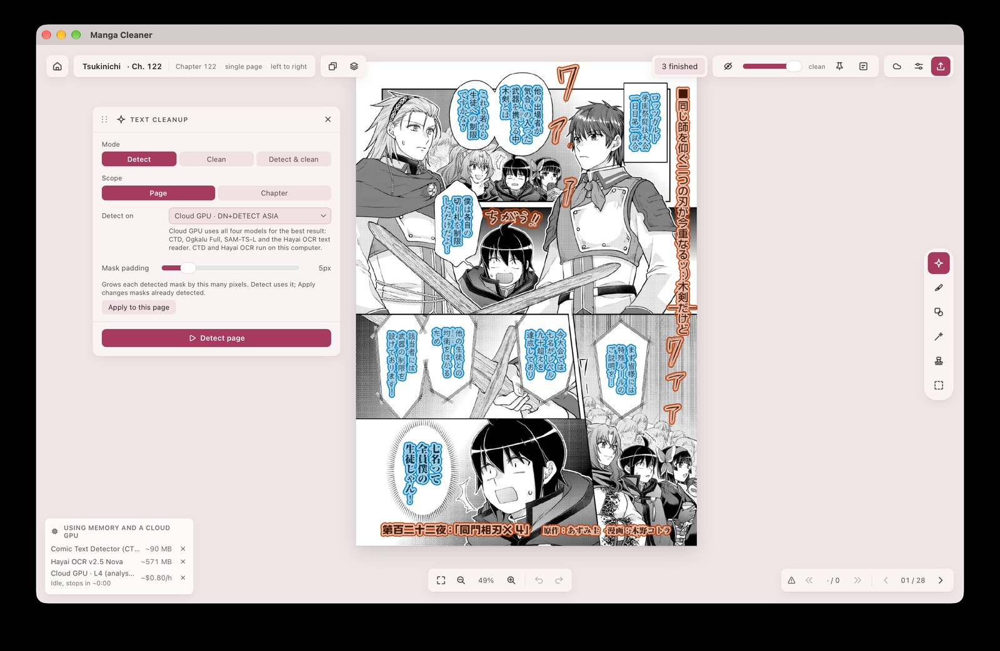

## See it work

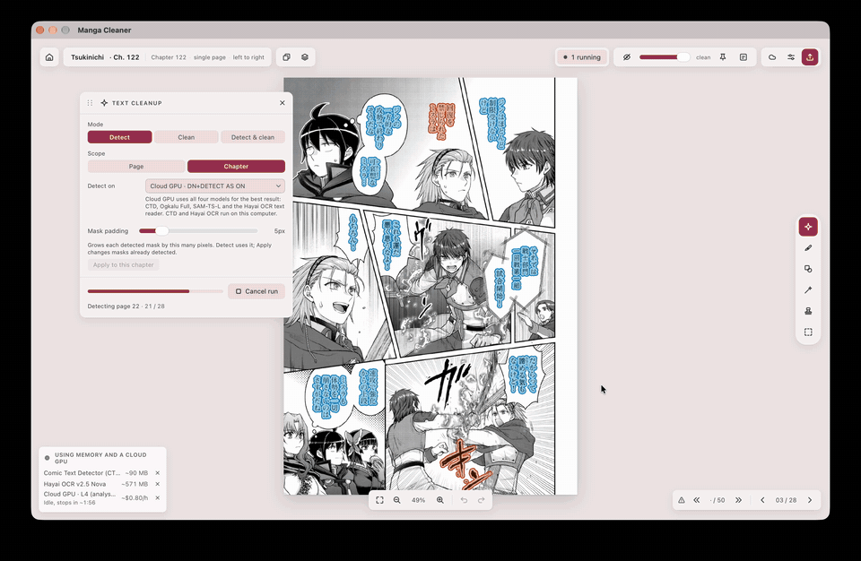

[Full quality video](docs/media/chapter-detect.mp4)

A chapter Detect run in the real app. Text inside speech bubbles is tinted blue and text outside bubbles is tinted orange. The Text cleanup panel is on the left, and a right-click on a region offers "Clean with".

## Demo: understand how LaMa works

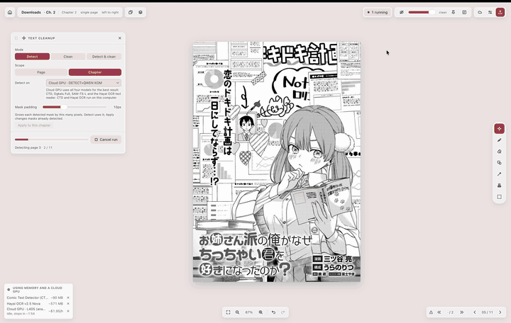

[Full quality video](infra/site/public/media/lama-demo.mp4) (the preview above plays at 4x speed)

The rule is simple: use the lightest engine that does the job.

- **Fill** handles text on flat paper. It paints one flat colour, measured from a thin ring of paper just outside the mask, exactly on the masked area.
- **Manga-LaMa** (the default) takes over when there is screentone, halftone or line art behind the text.
- **FLUX.2 Klein** (optional sidecar) is for the rare region nothing else can reconstruct. It needs its own process and several gigabytes of memory.
- **Cloud** runs on your own GPU account, per region, when you choose it.

A heavier model on a simple balloon is slower and often worse, because it can hallucinate marks where there was only paper. The video shows a chapter Detect run, then text over diagonal hatching cleaned with manga-LaMa from the right-click menu ("Clean with"). LaMa rebuilds the hatching lines behind the text instead of painting flat paper.

## Cloud Qwen: before and after

Regions from real chapters, cleaned with Qwen-Image-Edit-2511 on a cloud GPU. In each pair the left side is before and the right side is after. Qwen redraws the art under large sound effects, where there is no flat paper to fill.

<table>
  <tr>
    <td align="center" width="50%">
      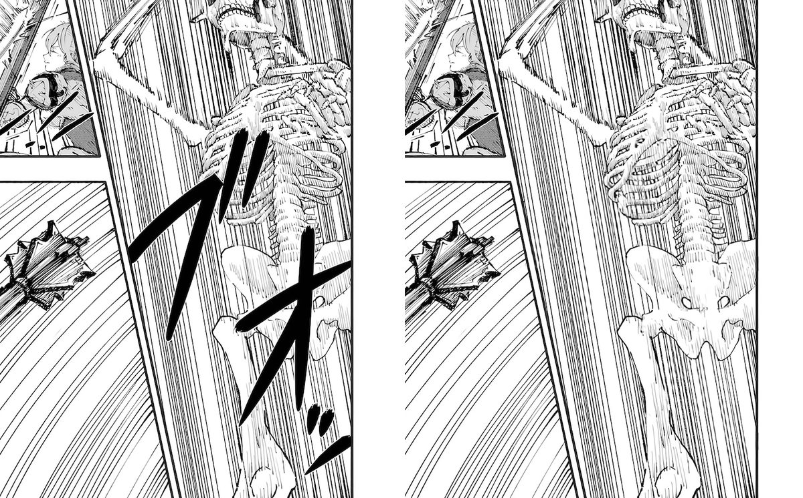<br>
      <sub>A sound effect over a skeleton and speed lines.</sub>
    </td>
    <td align="center" width="50%">
      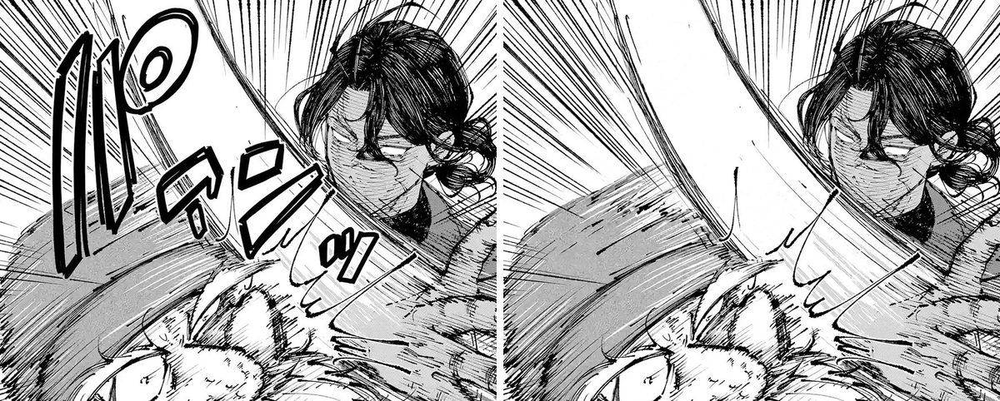<br>
      <sub>A sound effect over a swinging blade.</sub>
    </td>
  </tr>
  <tr>
    <td align="center" width="50%">
      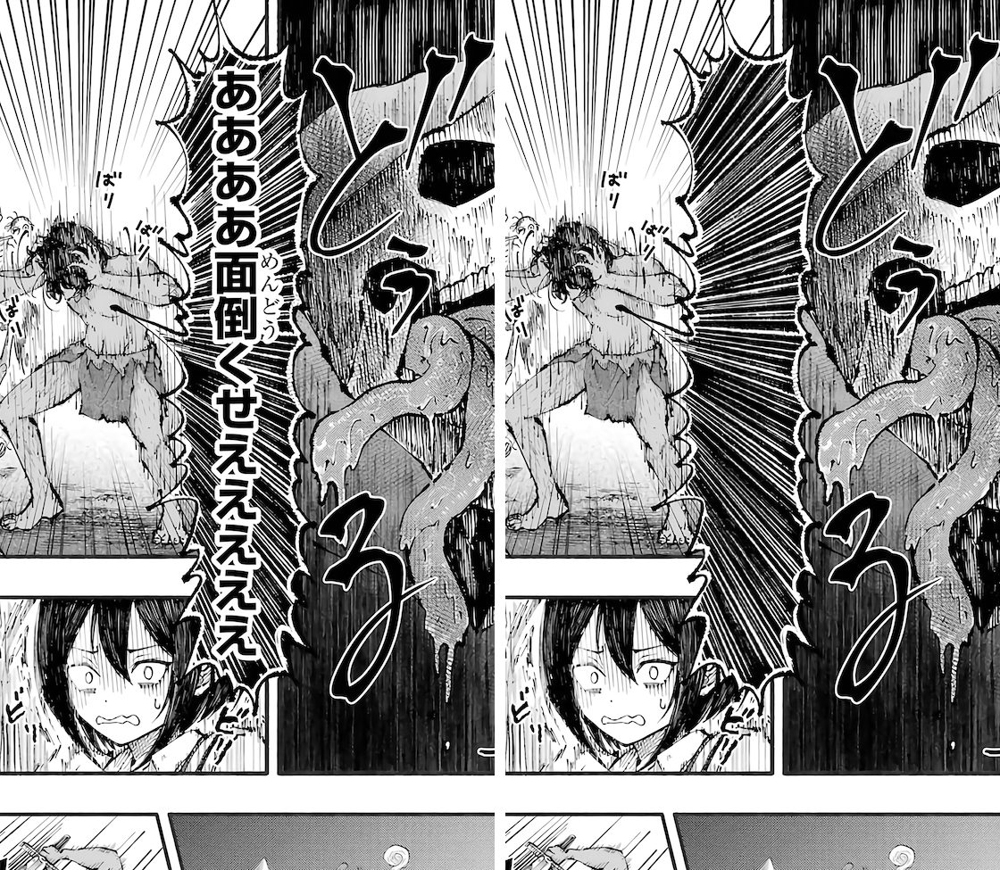<br>
      <sub>A long vertical shout over speed lines.</sub>
    </td>
    <td align="center" width="50%">
      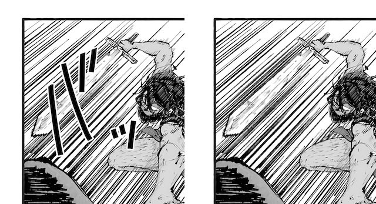<br>
      <sub>A sound effect over hatching and a raised sword.</sub>
    </td>
  </tr>
  <tr>
    <td align="center" width="50%">
      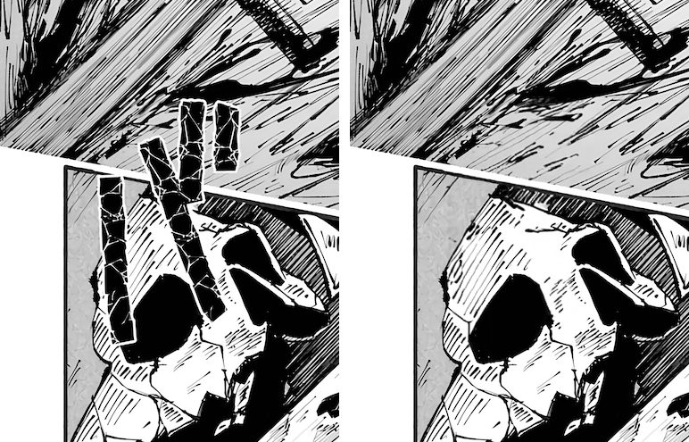<br>
      <sub>A sound effect over a skull.</sub>
    </td>
    <td align="center" width="50%">
      <br>
      <sub>Korean text over wallpaper in a colour webtoon.</sub>
    </td>
  </tr>
</table>

## How it works

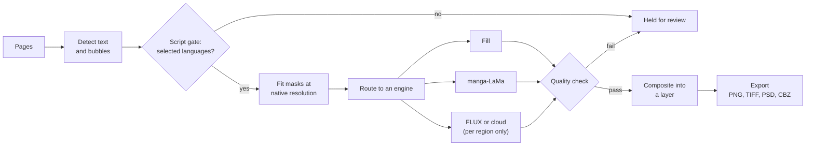

Detection finds text and bubbles. The script gate keeps the scripts you selected (Japanese, Chinese or Korean) and holds the rest for review. Each kept region gets a mask fitted at the page's own resolution, then goes to the lightest engine that suits it. An automatic run climbs from Fill to LaMa if the quality check rejects a result. A region no engine passes is left exactly as it was and listed for review. Each result is a layer with its engine, parameters and timing recorded, composited over the untouched source at export.

For the design, see [docs/architecture.md](docs/architecture.md). For the Detect, Clean and Text cleanup contract, see [docs/detect-clean.md](docs/detect-clean.md).

## Features

**Cleaning**
- Automatic pipeline: detect, gate to the scripts you choose, fit masks, route to an engine, clean, composite.
- Detect and Clean can run as separate steps, per page, chapter or project, so detected regions can be reviewed before anything is cleaned.
- Source language choices (Japanese, Chinese, Korean), and optional holding of English text for review.
- Optional Japanese text reader (manga-ocr) that rescues balloons the script gate cannot classify.
- Optional **Text-shaped review**: RT-DETR boxes and SAM-TS-L lettering pixels, with padding and brush corrections checked against a tinted write-support preview before any patch is applied. Writes are restricted to PNG pages on the measured configuration. See [docs/features.md](docs/features.md) and [docs/model-workflow-benchmarks.md](docs/model-workflow-benchmarks.md).
- Whole-chapter page denoise and sharpen presets, locally or on your cloud GPU.

**Editing tools**
- Six tools on the number keys 1 to 6: Text cleanup, Brush, Shapes, AI Mask Brush, Clone Stamp and Selection.
- Clone Stamp has a regional clone mode for moving a clipped piece of artwork, with feathering, rotation and duplicate.
- Hand-drawn masks are authoritative: nothing snaps to a detector, so what you painted is what is cleaned.

**Layers and history**
- Every cleaned region is a layer with its engine, parameters and timing recorded, re-runnable or deletable.
- Full undo and redo, saved to the project so a chapter reopened tomorrow can still take back today's work.
- A Needs review filter steps through held, declined and flagged regions.

**Long strips**
- Webtoon mode with virtual stitching, content-minimum splitting, and bounded-memory streaming across joins.
- A bubble that crosses a join is cleaned as one region.

**Export and colour fidelity**
- Untouched pixels stay bit-identical. 8 and 16-bit, Grayscale, RGB, CMYK and Indexed all survive.
- PNG, TIFF and layered PSD per page, with a mask file beside each page on request, or a whole chapter as CBZ.

**Models and acceleration**
- In-app model manager with SHA-256 verification and optional Hugging Face token support.
- Hardware acceleration chosen per model, overridable in **Settings › Acceleration**.

**Optional cloud GPU**
- Paste a Modal token or Beam API key and the app sets up the GPU endpoint for you, after you approve a plan.
- Off by default, every render is confirmed, and only a crop around the region is sent.

**Interface**
- Keyboard shortcuts for every tool and panel, rebindable in Settings.
- Interface languages: English, 한국어, 日本語, Español, Português and Français.
- Skippable first-launch setup that walks through model downloads, defaults, an optional cloud GPU and app behaviour.

## Screenshots

<table>
  <tr>
    <td align="center" width="50%">
      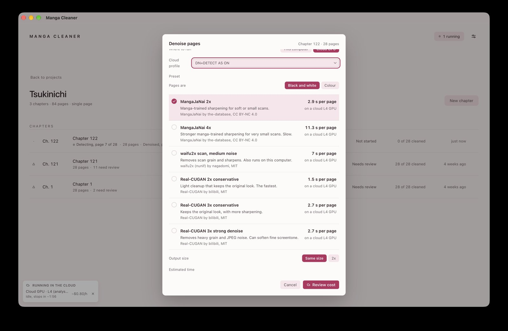<br>
      <sub>Denoise pages: presets, per-page time estimates and output size.</sub>
    </td>
    <td align="center" width="50%">
      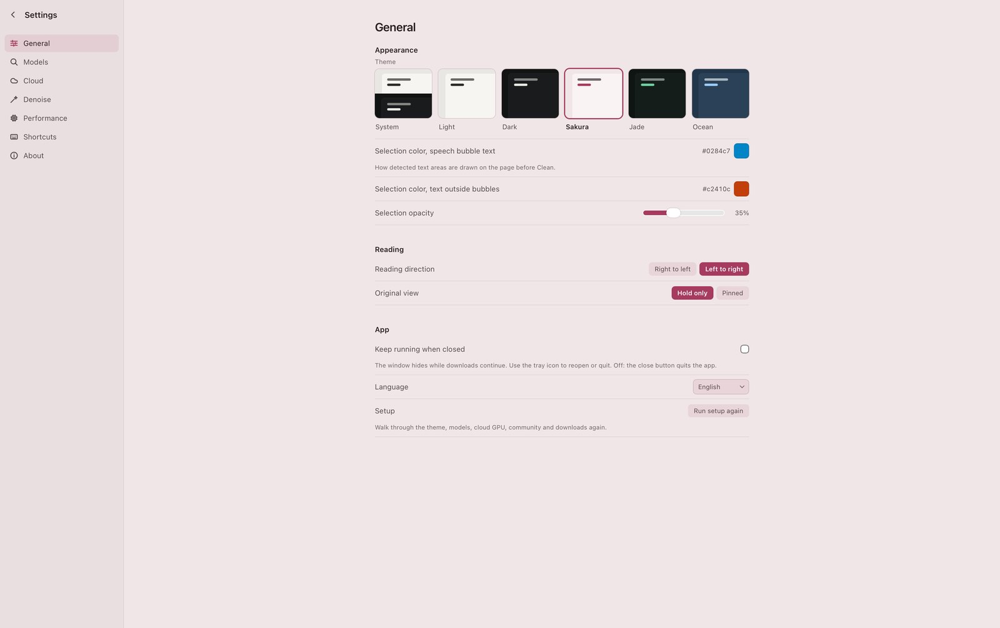<br>
      <sub>Settings: themes, selection colours, reading direction and language.</sub>
    </td>
  </tr>
</table>

## Install

Download the installer from [cleaner.komiq.cc](https://cleaner.komiq.cc). All installers are built by the release workflow, and the app updates itself from cryptographically signed manifests.

| Platform | Installer | Requirements | Notes |
|---|---|---|---|
| macOS, Apple Silicon | `.dmg` | macOS 11 or later | Intel Macs (`x86_64`) are unsupported: ONNX Runtime 1.28.0 publishes no `osx-x86_64` archive. |
| Windows x64 | `-setup.exe` | Windows 10 version 1803 x64 or later | Not yet Authenticode-signed, so SmartScreen warns the first time it is run. The release workflow signs it automatically as soon as a certificate is configured. |
| Linux x64 | `.AppImage` or `.deb` | System Vulkan loader for the GPU path | Has a release package and a GPU path (the WebGPU plugin, with CUDA flavours for NVIDIA) that has not been executed on real hardware. |
| Linux aarch64 | none | | Best effort, CPU only, and not part of the release workflow. |

Windows 10 version 1803 is what WebView2, the Visual C++ 2015-2022 runtime and ONNX Runtime 1.28 each require on their own. You do not need to install the Visual C++ runtime: the four libraries the ONNX Runtime imports outright ship beside the executable, where the loader finds them first.

**First launch.** Model weights and the runtime are not bundled, which keeps the installer small and respects weight provenance. The first-launch setup walks through the downloads, the defaults, an optional cloud GPU and app behaviour. Anything declined or missed can be fetched later from **Settings › Models**. For offline setups, place the verified files in the application's `models/` directory instead.

| Download | Size |
|---|---|
| ONNX Runtime | about 32 MB on macOS, about 200 MB on Windows |
| Five required model weights, in total | about 317 MB |
| Japanese text reader (optional, three files) | about 460 MB |

The Japanese text reader can be added from the same panel and selected for a legacy run's OCR rescue. Merely installing it does not switch the run.

## Models

Model weights live outside this repository. These models can be downloaded separately for the workflows that use them, under their own licences:

| Model | Upstream | Licence |
|---|---|---|
| `comictextdetector.onnx` | [dmMaze/comic-text-detector](https://github.com/dmMaze/comic-text-detector) via [manga-image-translator](https://github.com/zyddnys/manga-image-translator) | GPL-3.0 |
| `lama-manga.onnx` | [mayocream/lama-manga-onnx](https://huggingface.co/mayocream/lama-manga-onnx), finetuned from [advimman/lama](https://github.com/advimman/lama) by [dreMaz](https://huggingface.co/dreMaz/AnimeMangaInpainting) | MIT / Apache-2.0 |
| `image-script-identification-osd_lstm.onnx` | [ogkalu/image-script-identification](https://huggingface.co/ogkalu/image-script-identification) | Apache-2.0 |
| `image-script-identification-osd_labels.json` | [ogkalu/image-script-identification](https://huggingface.co/ogkalu/image-script-identification) | Apache-2.0 |
| `comic-text-and-bubble-detector-detector-v4-s_int8.onnx` | [ogkalu/comic-text-and-bubble-detector](https://huggingface.co/ogkalu/comic-text-and-bubble-detector) | Apache-2.0 |
| `manga-ocr-encoder_model.onnx`, `manga-ocr-decoder_model.onnx`, `manga-ocr-vocab.txt` (optional, 460 MB) | [mayocream/manga-ocr-onnx](https://huggingface.co/mayocream/manga-ocr-onnx), an ONNX export of [kha-white/manga-ocr-base](https://huggingface.co/kha-white/manga-ocr-base) | Apache-2.0 |

The optional Text-shaped review adds the full RT-DETR graph and the Koharu SAM-TS-L model. The licence position on each is in the [model rights decision](docs/model-rights-decision.md).

## Acceleration

Providers are picked per model from runtime hardware detection and suitability benchmarks. Override them in **Settings › Acceleration** (`auto`, `cpu`, or an explicit provider).

| Platform | Providers | Default | Status |
|---|---|---|---|
| macOS (Apple Silicon) | WebGPU, CoreML, CPU | WebGPU for manga-LaMa, CoreML for the detector, CPU for script ID and balloon | Measured on Apple M-series |
| Windows (x64 / arm64) | DirectML, WebGPU (plugin), CPU | DirectML for GPU detection and inpainting on NVIDIA, AMD, and Intel; the WebGPU plugin beside it | Designed; unmeasured on real hardware |
| Windows (x64, NVIDIA) | CUDA 12/13, TensorRT, WebGPU (plugin), CPU | Optional flavour; detector and LaMa on CUDA, the WebGPU plugin as the fallback | Optional; needs user-installed CUDA and cuDNN |
| Linux (x64) | WebGPU (plugin), CPU | WebGPU plugin over Vulkan (NVIDIA, AMD, Intel; needs the system Vulkan loader) | Designed; unmeasured on real hardware |
| Linux (x64, NVIDIA) | CUDA 12/13, TensorRT, WebGPU (plugin), CPU | Optional flavour, same terms as Windows | Optional; unmeasured on real hardware |
| Linux (aarch64) | CPU | CPU | Best effort; no CUDA archive or plugin is published |
| macOS (Intel x86_64) | None | N/A | Unsupported under ONNX Runtime 1.28 |

## Build from source

You need a stable [Rust](https://www.rust-lang.org/) toolchain, [Node.js](https://nodejs.org/) 20.19 or 22.12 and newer, and the [Tauri 2 system dependencies](https://v2.tauri.app/start/prerequisites/) for your platform. Quick start for a development run:

```bash
npm install
scripts/fetch-runtime.sh
scripts/fetch-models.sh
npm run helpers
npx tauri dev
```

`fetch-runtime.sh` and `fetch-models.sh` download into `runtimes/` and `models/` and check every SHA-256. The app does not read those folders on its own: point `ORT_DYLIB_PATH` and `MANGA_CLEANER_MODELS` at them, or download the runtime and models from **Settings** inside the app. `npm run helpers` freezes the cloud setup helper; run it again after any edit under `provisioner/` or `deploy/`.

Run the tests:

```bash
npm test
cargo test --workspace --exclude spike-strip-memory -- --test-threads=1
```

`--test-threads=1` is required because concurrent WebGPU session start-up on macOS can abort the test binary.

Release builds need more: the frozen helper and `uv` staged for the target, the Visual C++ runtime on Windows, and signing. The [developer guide](docs/developer-guide.md) covers the full setup, every test suite, environment variables, common changes and the release process.

## Built with

[Tauri 2](https://v2.tauri.app/) for the shell, [Svelte 5](https://svelte.dev/) for the interface, a pure [Rust](https://www.rust-lang.org/) core for the pipeline, [ONNX Runtime](https://onnxruntime.ai/) for inference, and pure-Rust image I/O throughout. The pipeline needs no Python. The one Python program the installer ships, the cloud setup helper, is frozen into its own executable and runs only while you set up, resume or remove a cloud GPU.

## Documentation

The full index is in [docs/README.md](docs/README.md). The main entries:

- [docs/features.md](docs/features.md): what the app does, tool by tool, with the default shortcuts.
- [docs/architecture.md](docs/architecture.md): how the app is put together.
- [docs/detect-clean.md](docs/detect-clean.md): the Detect, Clean and Text cleanup contract.
- [docs/developer-guide.md](docs/developer-guide.md): setup, tests and releases.
- [docs/cloud-contract.md](docs/cloud-contract.md): the cloud wire contract.
- [docs/findings.md](docs/findings.md): what was measured and learned while building it: hardware, engines, memory, colour, packaging.
- [infra/site/README.md](infra/site/README.md): how [cleaner.komiq.cc](https://cleaner.komiq.cc) serves the download page and the release bucket.

## Project status

Beta. The frontend is complete and tested, and the Rust backend runs a page end to end: detection, bubble classification, script gating, mask fitting, fill and LaMa inpainting, compositing, and export with asserted colour fidelity.

**Measured:** the Apple Silicon path, on one Apple M-series machine. The optional FLUX.2 Klein sidecar runs over loopback HTTP and is measured on Apple Silicon.

**Not measured or not validated:**
- Windows and Linux runtime and GPU figures are unmeasured on physical hardware.
- Virtual stitching and streaming memory boundaries for long-strip webtoons are implemented, but cross-join detection overlap and real-world memory bounds are not yet measured against a large corpus.
- Known issues in the ladder: manga-LaMa can leave phantom text marks inside bubbles, quality metrics need tuning for outline-dominated regions, and the escalation path wants testing on more screentone fixtures.
- The FLUX.2 Klein sidecar is not yet validated across general manga styles.
- The optional cloud GPU path (automatic Modal or Beam setup, a confirmation per render, cancel and recovery) is built and tested offline against fakes. It has had limited live runs on a Modal account and none on Beam. Broad results on real manga are not measured.
- Text-shaped review writes are qualified only for PNG pages on the measured Apple M5/WebGPU configuration.

The detail, with the conditions of every number, is in [docs/findings.md](docs/findings.md).

## Licence

Manga Cleaner is currently released under the [GNU General Public License v3.0 only](LICENSE). This is the licence for the application; separately downloaded model weights retain their own licences. Complete corresponding source is available at [github.com/k-omiq/manga-cleaner](https://github.com/k-omiq/manga-cleaner) pursuant to GPL-3.0 §6.

With thanks to `comic_text_detector` and `manga-image-translator` (text segmentation), `lama-manga`, `advimman/lama` and `dreMaz` (manga inpainting), `ogkalu` (script identification and bubble detection), `kha-white` and `mayocream` (Japanese text recognition), and to [ONNX Runtime](https://onnxruntime.ai/), [Tauri](https://tauri.app/), and [Svelte](https://svelte.dev/).
