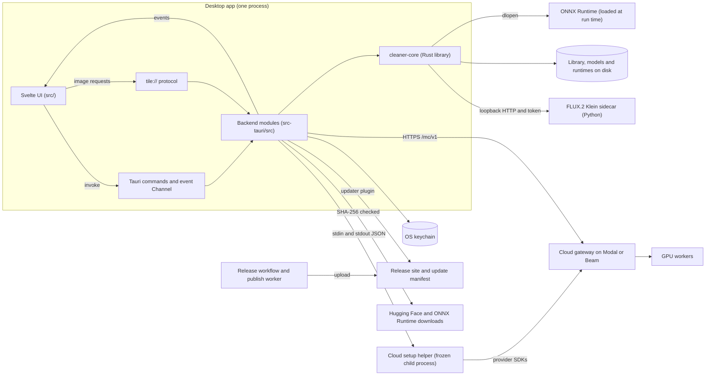
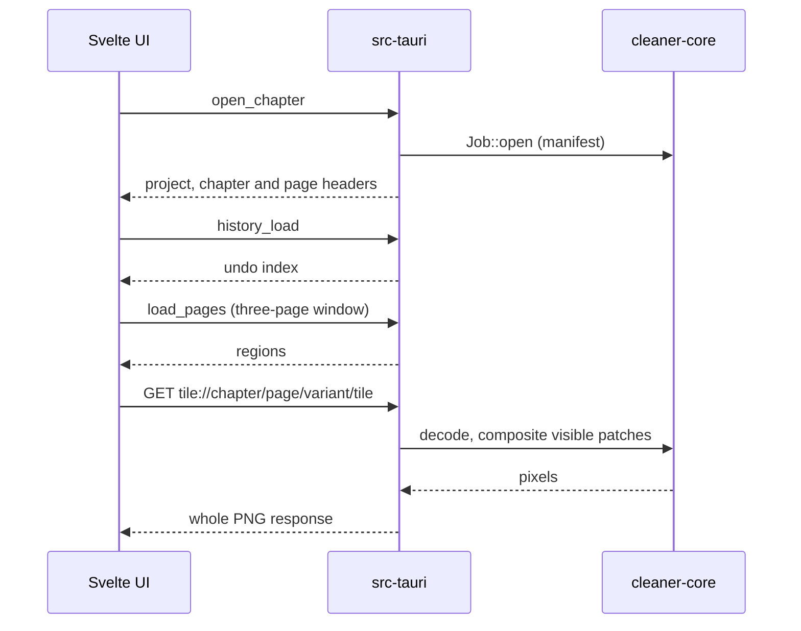
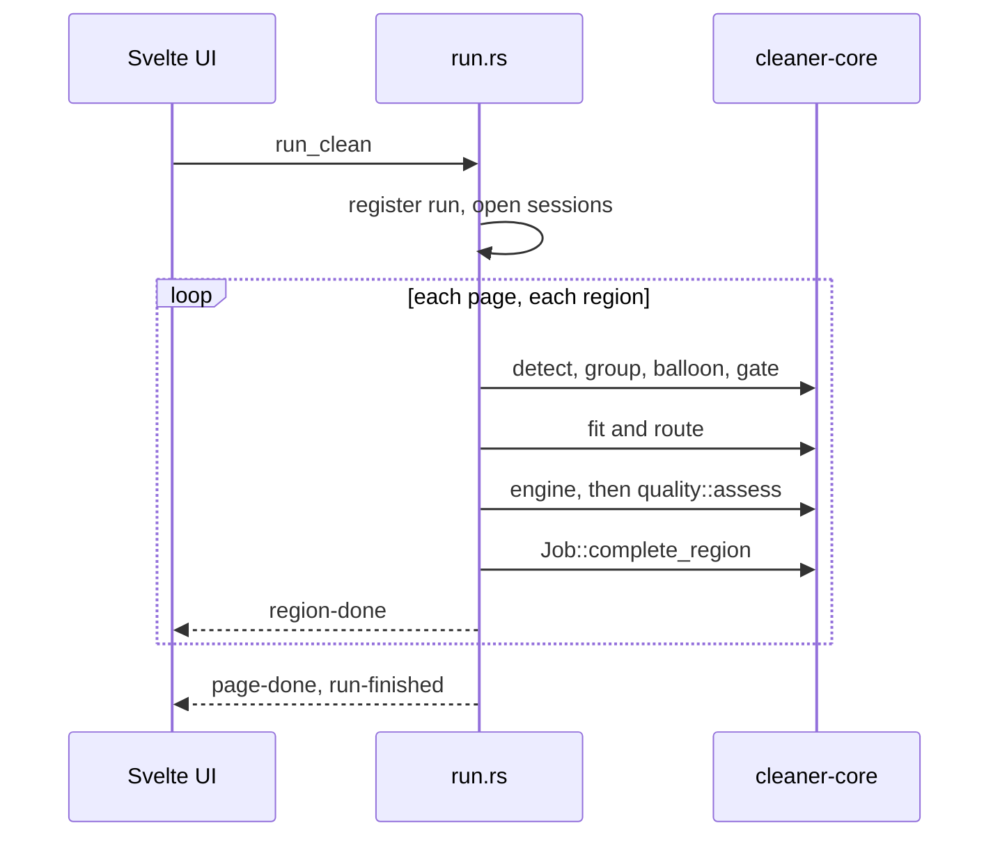
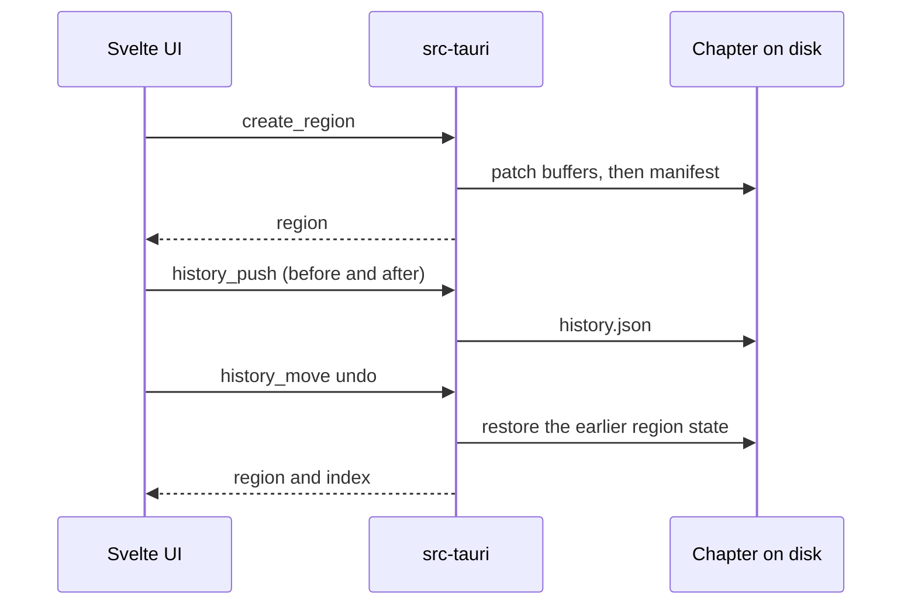
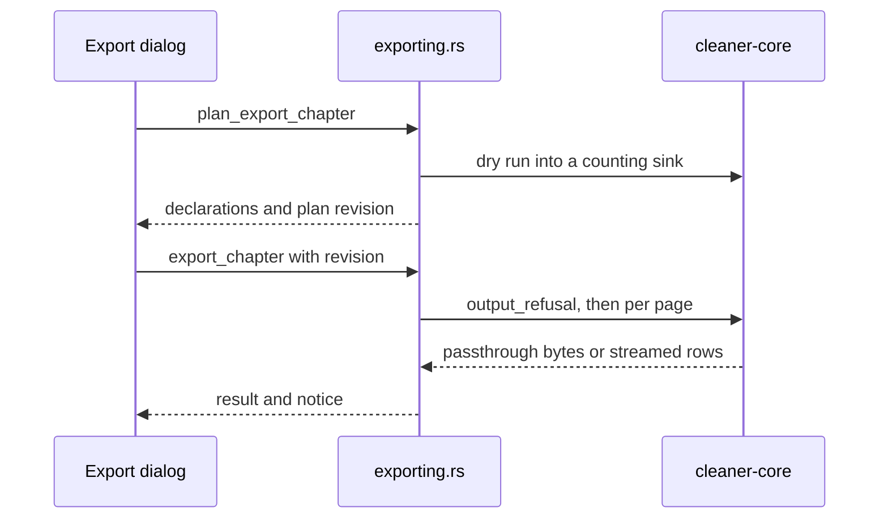
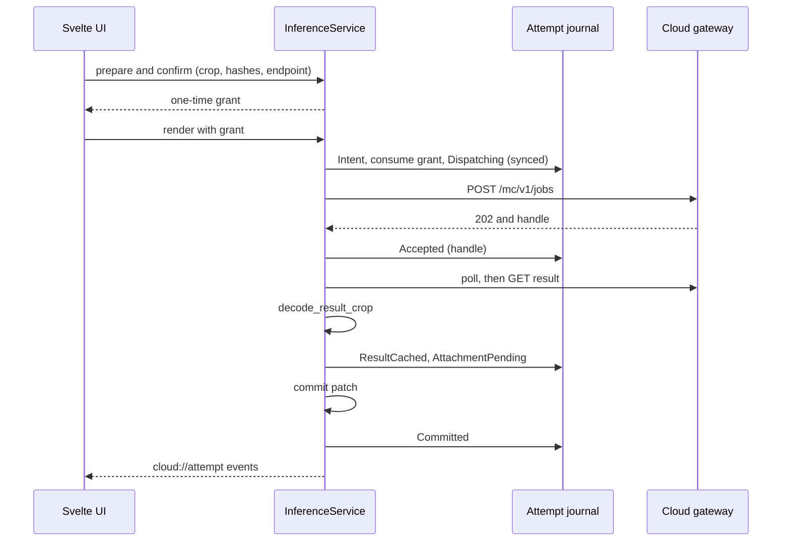
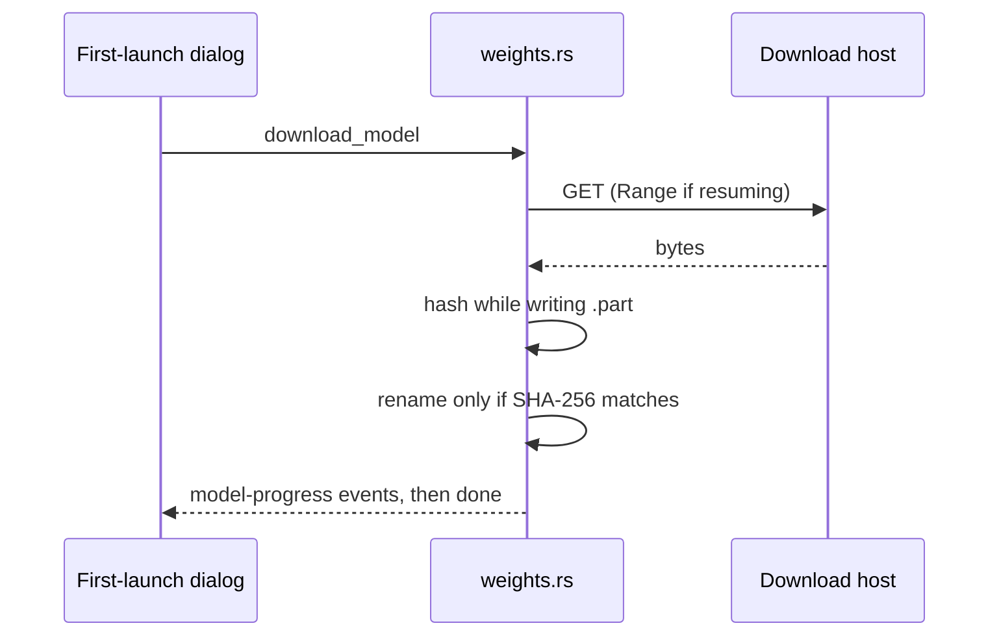

# Architecture

How Manga Cleaner is built. Read the [README](../README.md) first for what the app is and how to install it, and [features.md](features.md) for what each control does. This document explains where the code lives, how the parts talk to each other, and which rules the code enforces.

## 1. Overview

Manga Cleaner is a desktop app that removes Japanese lettering from manga and webtoon pages. A Svelte 5 interface runs in a Tauri 2 webview. It talks to a Rust backend (`src-tauri`) through Tauri commands, one ordered event channel, and a custom `tile://` image protocol. The backend is a thin adapter over `cleaner-core`, a pure Rust library that does all the image work: ingest, detection, script gating, mask fitting, cleaning engines, compositing, project storage and export. Models run on ONNX Runtime, which the app downloads and loads at run time. Three optional pieces sit outside the process: a local FLUX.2 Klein sidecar (Python, loopback HTTP), a frozen cloud setup helper (a child process), and a GPU gateway in the user's own Modal or Beam account (HTTPS). Nothing leaves the machine unless the user sets up the cloud and confirms each render.

## 2. System diagram

## 3. Repository layout

| Path | What it owns |
|---|---|
| [`src/`](../src) | The Svelte 5 interface, its backend seam, and a mock backend for running in a plain browser. |
| [`src-tauri/`](../src-tauri) | The Tauri host crate (`manga-cleaner`): commands, `tile://` protocol, library, runs, cloud client, settings. Also `capabilities/`, `permissions/`, `build.rs` and debug probes in `examples/`. |
| [`crates/cleaner-core/`](../crates/cleaner-core) | The pipeline library. No Tauri dependency. |
| [`deploy/cloud/`](../deploy/cloud) | The Python `/mc/v1` gateway and GPU workers for Modal and Beam, their tests, and JSON fixtures shared with the Rust wire code. |
| [`provisioner/`](../provisioner) | The Python cloud setup helper. Frozen into a binary for releases. |
| [`sidecar/`](../sidecar) | The optional local FLUX.2 Klein worker. See [sidecar/README.md](../sidecar/README.md). |
| [`sam-bootstrap/`](../sam-bootstrap) | A script that downloads the SAM-TS-L checkpoint and exports its ONNX graphs. Bundled as an app resource and run by the managed Python. |
| [`infra/`](../infra) | Two Cloudflare Workers: `site/` serves the download page and reads releases from R2, `publish-worker/` takes authenticated uploads. See [infra/site/README.md](../infra/site/README.md). |
| [`scripts/`](../scripts) | Fetch scripts for models and the runtime, helper rebuilds, release and ship scripts, a PSD checker and the smoke-page generator. |
| [`.github/`](../.github) | `ci.yml`, `release.yml` and the helper-staging scripts. |
| [`spikes/`](../spikes) | Measurement experiments. Rust spikes are workspace members and Python ones are excluded. Not production code, though the release bundles a few files from `spikes/sam-ts-l`. |
| [`fixtures/`](../fixtures) | Synthetic smoke pages. They are not a quality corpus. |
| [`docs/`](.) | Reference documents. |
| [`promo/`](../promo) | The promo video pipeline: scenes, recordings and renders. |
| [`design/`](../design) | The app icon master and design explorations. |
| `external/koharu` | A Git submodule of the upstream Koharu project. Nothing builds from it. |
| `freeditor/` | A local nested clone of another project. It is ignored by Git and never committed. |
| `models/`, `runtimes/`, `dist/`, `target/` | Ignored: downloaded weights, downloaded runtimes, the Vite build and Cargo output. |

## 4. Layers

### 4.1 Frontend (`src/`)

- **Backend seam.** [`src/lib/api/backend.js`](../src/lib/api/backend.js) defines every call the interface may make. No component imports a backend directly. Every method is async. Progress arrives only on the event channel. No English text crosses the seam: errors and notices are i18n keys plus parameters.
- **Two implementations.** [`tauri.js`](../src/lib/api/tauri.js) maps each seam method to a Tauri command. [`mock.js`](../src/lib/api/mock.js) is a complete in-memory backend with fixture chapters. It serves a plain browser (`npm run dev`) and the tests, and it supplies default settings inside Tauri. `getBackend()` chooses between them. [`tauri-events.js`](../src/lib/api/tauri-events.js) opens the Tauri `Channel` once for the window's life.
- **Image URLs.** [`tile.js`](../src/lib/api/tile.js) builds `tile://` URLs and the proxy tile plan. The `v` parameter is a hash of content and appearance digests, never a timestamp.
- **State.** [`src/lib/state/`](../src/lib/state) holds Svelte 5 rune singletons: `app` (route, modal stack, notices), `editor` (open chapter, tool values, runs, undo index), `session` (preferences), `jobs`, `cloud`, `capabilities` and `loadedModels`. [`pagewindow.svelte.js`](../src/lib/state/pagewindow.svelte.js) keeps regions resident for the previous, current and next page only. This is safe because the interface never holds an unsaved edit.
- **Editor.** [`src/lib/editor/`](../src/lib/editor) has the canvas, the virtualised longstrip column, the tool rail and the pointer gesture code. [`tools.js`](../src/lib/editor/tools.js) declares the six tool slots and their parameters. Cleaned regions draw as transparent patch layers over source tiles ([`patchlayers.svelte.js`](../src/lib/editor/patchlayers.svelte.js)), so an edit never repaints a whole page.
- **Other modules.** `dialogs/` (settings, export, consent, first-launch setup), `home/` (library screens), `shell/` (keyboard layer, modal host, jobs indicator), `ui/` (stateless primitives), `model/` (pure rules such as the engine ladder and undo arithmetic), `i18n/` (six catalogues and `t()`), [`shortcuts.js`](../src/lib/shortcuts.js) (the only place a keybinding is declared) and [`updater.js`](../src/lib/updater.js) (wraps the updater plugin).
- **Browser storage.** Only per-viewer conveniences: preferences and the editor's last position, under the `mangaCleaner.` key prefix. Real settings live in the backend.

### 4.2 Backend (`src-tauri/`)

[`lib.rs`](../src-tauri/src/lib.rs) builds the app: single-instance guard, tray and quit guard, the dialog, updater, process and opener plugins, the `tile` protocol, and one `generate_handler!` list of every command. A command must appear in three places: that list, the `commands` manifest in [`build.rs`](../src-tauri/build.rs), and a permission in [`permissions/`](../src-tauri/permissions). A frontend test checks all three agree.

| Module | Responsibility |
|---|---|
| [`library.rs`](../src-tauri/src/library.rs) | Projects and chapters over the core's job manifest. `index.json` holds only the grouping and names a manifest cannot. Chapters copy their pages into their own sidecar directory, so deleting the scan folder breaks nothing. |
| [`run.rs`](../src-tauri/src/run.rs) | The batch scheduler: `run_clean`, cancel, resume. Pipeline sessions, the escalation loop, one page held at a time, and a `run-finished` event for every run. |
| [`region.rs`](../src-tauri/src/region.rs), [`underlay.rs`](../src-tauri/src/underlay.rs) | Single-region edits: `apply_tool`, `create_region`, `rerun_mask`, `clean_anyway`. They reuse the run's ladder and read only a bounded window around the region. |
| [`tile.rs`](../src-tauri/src/tile.rs) | The `tile://` handler. Answers whole PNG responses on a blocking thread, with a bounded proxy-tile cache. |
| [`history.rs`](../src-tauri/src/history.rs) | The undo journal on disk, with a user-set cap. |
| [`exporting.rs`](../src-tauri/src/exporting.rs) | Chapter export planning and writing, with named refusals. |
| [`weights.rs`](../src-tauri/src/weights.rs), [`models.rs`](../src-tauri/src/models.rs), [`model_workflows.rs`](../src-tauri/src/model_workflows.rs) | The pinned model catalogue and verified downloads, loaded-session listing and unload, and the optional text-shaped review workflows. |
| [`page_denoise.rs`](../src-tauri/src/page_denoise.rs), [`denoise_history.rs`](../src-tauri/src/denoise_history.rs) | Whole-page denoise and its record. |
| [`settings.rs`](../src-tauri/src/settings.rs) | `settings.json`: shallow merge, atomic write, owner-only permissions, secrets refused. |
| [`inference/`](../src-tauri/src/inference) | The cloud client: config, secrets, consent, grants, journal, HTTPS transport, the render service, and the cloud clean, denoise and analysis commands. |
| [`provision.rs`](../src-tauri/src/provision.rs), [`flux_install.rs`](../src-tauri/src/flux_install.rs) | Spawn the cloud helper, and install the FLUX helper with the bundled `uv`. |
| [`jobs.rs`](../src-tauri/src/jobs.rs), [`events.rs`](../src-tauri/src/events.rs) | The registry of running work that feeds the quit guard, and the event registry that fans typed events out to the webview. |
| [`smoke.rs`](../src-tauri/src/smoke.rs) | The headless launch check used by the release workflow. |

Events on the `subscribe_events` channel are `page-started`, `region-done`, `page-done`, `run-finished`, `model-progress`, `history-changed` and `notice`. Long-running cloud and denoise work uses named window events (`cloud://attempt`, `cloud://analysis`, `provision://progress`, `denoise://progress`, `denoise://recorded`), and the quit guard raises `app://quit-requested`.

### 4.3 Core (`crates/cleaner-core`)

| Stage | Modules | What it does |
|---|---|---|
| Image I/O | [`image/`](../crates/cleaner-core/src/image), [`ingest.rs`](../crates/cleaner-core/src/ingest.rs) | Pure-Rust codecs. Samples, palettes, ICC profiles, orientation and PNG metadata are carried as data. Ingest sniffs headers, imports PNG, TIFF and JPEG byte for byte, converts WebP, GIF and BMP to PNG, and skips any file that does not fully decode. |
| Detection | [`detect/`](../crates/cleaner-core/src/detect), [`balloon.rs`](../crates/cleaner-core/src/balloon.rs), [`text_groups.rs`](../crates/cleaner-core/src/text_groups.rs) | Text segmentation and boxes, speech-bubble detection, and grouping of lettering pixels into cleaning units. Raw evidence is stored and never rewritten. |
| Gate | [`gate/`](../crates/cleaner-core/src/gate) | Script identification and optional OCR. Default is to leave text alone. |
| Fit and route | [`fit/`](../crates/cleaner-core/src/fit) | Grows a mask in steps that stop at strong edges, samples a ring of paper, and routes to Fill or Inpaint. |
| Engines | [`engines/`](../crates/cleaner-core/src/engines), [`paint/`](../crates/cleaner-core/src/paint), [`quality.rs`](../crates/cleaner-core/src/quality.rs) | Fill (flat colour), LaMa (ONNX inpainting), the FLUX crop renderer, host-side tone alignment, and the brush and clone tools. `quality::assess` scores every engine's output with one decline metric. |
| Project | [`project/`](../crates/cleaner-core/src/project), [`patch.rs`](../crates/cleaner-core/src/patch.rs), [`mask.rs`](../crates/cleaner-core/src/mask.rs) | The `.mtclean` manifest, raw patch buffers, cross-process locking and provenance. |
| Composite and export | [`composite.rs`](../crates/cleaner-core/src/composite.rs), [`export/`](../crates/cleaner-core/src/export), [`strip/`](../crates/cleaner-core/src/strip) | Stamps ordered patches onto a page. Streams PNG, TIFF, layered PSD, mask files and CBZ. Longstrip maths: joins, content-minimum splits and decode windows. |
| Models and hardware | [`runtime/`](../crates/cleaner-core/src/runtime), [`accel.rs`](../crates/cleaner-core/src/accel.rs), [`registry.rs`](../crates/cleaner-core/src/registry.rs), [`residency.rs`](../crates/cleaner-core/src/residency.rs), [`memory.rs`](../crates/cleaner-core/src/memory.rs) | Runtime loading, provider choice, a registry of loaded sessions, a checkout/checkin cache that keeps models warm, and memory-pressure reads. |
| Review and denoise | [`sam_ts.rs`](../crates/cleaner-core/src/sam_ts.rs), [`rt_regions.rs`](../crates/cleaner-core/src/rt_regions.rs), [`fusion.rs`](../crates/cleaner-core/src/fusion.rs), [`text_shape.rs`](../crates/cleaner-core/src/text_shape.rs), [`page_denoise.rs`](../crates/cleaner-core/src/page_denoise.rs) | The optional text-shaped review, with versioned write-support masks, and whole-page denoise. |
| Wire types | `cloud_*.rs`, [`sidecar/`](../crates/cleaner-core/src/sidecar) | Cloud request and response schemas, canonical digests, tiling and the bounded result decoder. The loopback client for the sidecar. |

The engine ladder is Fill, LaMa, FLUX sidecar, then cloud. Brush and clone strokes are recorded as engines but are not rungs. Detection details are in [detect-clean.md](detect-clean.md). Approved SAM component writes follow [component-write-contract.md](component-write-contract.md).

### 4.4 Cloud

The cloud path is optional and runs in the user's own account. It has four parts.

- **Setup helper** ([`provisioner/`](../provisioner)). The app spawns it with a cleared environment and one JSON request on stdin (at most 64 KiB). It answers with one JSON document on stdout and progress lines on stderr. Operations are inspect, plan, apply, resume, cleanup and probe. A journal records each resource before it is created, so a killed run can resume. See [cloud-provisioning.md](cloud-provisioning.md).
- **Gateway and workers** ([`deploy/cloud/`](../deploy/cloud)). [`common/api.py`](../deploy/cloud/common/api.py) is a provider-neutral CPU gateway for `/mc/v1` (render), `/mc/analysis/v1` and `/mc/denoise/v1`. [`modal/`](../deploy/cloud/modal) and [`beam/`](../deploy/cloud/beam) bind it to each provider. GPU workers load pinned weights from a volume once per container and scale to zero. The wire contract is [cloud-contract.md](cloud-contract.md).
- **Desktop client** ([`src-tauri/src/inference/`](../src-tauri/src/inference)). Consent and grants ([cloud-consent.md](cloud-consent.md)), credentials and profiles ([cloud-security.md](cloud-security.md)), the hardened HTTPS client and result decoder ([cloud-transport.md](cloud-transport.md)), and the attempt journal ([cloud-journal.md](cloud-journal.md)). The interface side is [cloud-frontend.md](cloud-frontend.md).
- **Recovery.** The interface asks for a recovery sweep at start and before a cloud clean. See flow (e).

Automatic runs never reach the cloud. A render goes out only with a grant for that region. Cloud analysis and denoise have their own consent: analysis uploads overlapping tiles of a page and denoise uploads a whole page.

### 4.5 Sidecar

[`sidecar/manga_cleaner_sidecar`](../sidecar/manga_cleaner_sidecar) is a small HTTP server that renders one crop at a time with FLUX.2 Klein, through `mflux` on Apple Silicon or `torch` and `sdnq` elsewhere. The core spawns it, passes a port, a random token and memory limits in `MC_SIDECAR_*` variables, and talks to it over `127.0.0.1` with an `x-mc-token` header. `GET /v1/health` needs no token. A watchdog thread ends the process when the parent dies. The app ships no Python for it: the user installs it from Settings, using a bundled `uv`. It is never reached by an automatic run. The wire is documented at the top of [`sidecar/mod.rs`](../crates/cleaner-core/src/sidecar/mod.rs).

## 5. Key flows

### (a) Opening a chapter and showing a page

1. The user opens a chapter. The editor state calls `openEditorChapter`, and the `open_chapter` command reads the library index and the `.mtclean` manifest.
2. The reply carries the project and the chapter: page headers, region counts and input reports. The editor then loads the undo index with a separate `history_load` call. Notices are emitted from the command, not from the library model.
3. The page window loads full regions for the current page and its neighbours with `load_pages`. Other pages stay as headers.
4. The canvas sets `` sources to `tile://` URLs. The handler runs on a blocking thread, reads the manifest (shared while unchanged), decodes the page, composites visible patches, cuts proxy tiles and caches them.

### (b) Automatic text cleanup of a page

`run_clean` registers the run and opens the detection and gate sessions once per run. It holds one page at a time, not the chapter: it takes the job briefly to read a page's inputs and again to save the results, and the models run with the job free, so hand edits on other pages go through at once. For each page, the scheduler emits `page-started`, then for each region:

1. **Detect.** Segment text and propose boxes, then group lettering pixels into cleaning units.
2. **Balloon.** Decide once whether the text is inside a speech bubble.
3. **Gate.** Judge the script. Only a confident verdict cleans. Everything else is held for review.
4. **Fit.** Grow the mask to the strongest-edge limit and sample the paper ring. The result routes to Fill or Inpaint.
5. **Clean.** Run the routed engine. `quality::assess` scores the result. A decline escalates to the next permitted engine. If the top permitted engine declines too, the region is left as it was and listed for review.
6. **Save.** `Job::complete_region` writes the patch buffers, appends the record and rewrites the manifest. Then the scheduler emits `region-done`.

After the last region the page is marked examined and `page-done` follows. A run ends with exactly one `run-finished`, even after a panic. Compositing does not happen in the run: the saved patch is a layer, composited later by the tile protocol and the exporter.

### (c) A manual tool edit, then undo and redo

1. A pointer gesture builds a draft. On release, `commitDraft` calls `create_region` (brush, shapes, AI mask brush, clone) or `edit_detection_mask` (mask select).
2. The backend reads a bounded window around the region ([`underlay.rs`](../src-tauri/src/underlay.rs)), runs the named engine, and commits through `Job::complete_region`. A hand-drawn mask is authoritative: no detector snaps it.
3. The reply carries the updated region. The interface swaps it in and calls `history_push` with a before and after snapshot of the region's metadata.
4. The layer URL changes because its `v` hash changes, so the canvas loads the new patch only.
5. **Undo** calls `history_move`. The journal reads one entry from `history.json` and replays it as a state restore (`restoreRegion`, or `setRegionCleaned` for a clean the backend recorded itself). Masks are soft-deleted, so nothing renders again.

### (d) Export with colour and bit-depth fidelity

1. The export dialog calls `plan_export_chapter`. The backend validates every page against a counting sink, so nothing is written, and returns the declarations and a plan revision, a SHA-256 over the manifest, the source bytes, the patch pixels and the chosen options. If the chapter or the choices change, the revision no longer matches and a fresh plan is needed.
2. `export_chapter` takes the chapter lock and checks the plan revision. It then applies the named refusals (lossy formats, stitched CBZ or PSD, indexed PSD, mismatched strips) and `Job::output_refusal`, which forbids writing over any source.
3. For each page, only the patches that intersect it are selected from the manifest's bounding boxes. A page with none, exported to a compatible format, is copied byte for byte. Otherwise the page is composited and encoded straight into the file, without building the whole output in memory.
4. The writers keep the source mode, depth, palette and ICC profile. When a target format cannot carry something, the export declares the change instead of converting silently.

### (e) A cloud clean: consent, crop, journal, validation, recovery

1. **Prepare.** With cloud engines allowed and a profile selected, the backend loads the real source page and the stored region mask under the chapter lock. It cuts a crop snapped to a 16-pixel stride with context padding, encodes the crop and hint PNGs, hashes them, and caches a proposal that expires in minutes. The caller supplies no hashes.
2. **Confirm.** The dialog shows what is sent, to which endpoint, and the cost. On confirmation the backend revalidates source, mask and revision, then mints a one-time grant bound to those values.
3. **Intent.** The service writes the attempt's intent to the journal and syncs it, consumes the grant, and writes `Dispatching`. Only then does it send `POST /mc/v1/jobs` (metadata, crop, hint) with the credential read from the keychain.
4. **Accepted.** The gateway's handle is persisted before any polling. The client polls and downloads the result.
5. **Validate.** `decode_result_crop` checks the PNG against the declared size, stride and digest. Only a valid result is cached (`ResultCached`).
6. **Attach.** The service records `AttachmentPending` with a stable patch id, compares the region snapshot, commits the patch (`Committed`) and the backend records an undo step. A drifted region fails closed and the cached result is kept for inspection.
7. **Recovery.** At start and before the next cloud clean, a sweep ends every attempt. An interrupted `Intent` or `Dispatching` becomes `Unknown` and is never resubmitted: the user decides. An accepted job is polled by its stored handle. A cached or pending result is attached if its region is unchanged, and otherwise ends as failed.

### (f) First-launch model and runtime download

1. The first-launch dialog lists the catalogue with `list_models` and calls `download_runtime` and `download_model`.
2. [`weights.rs`](../src-tauri/src/weights.rs) streams each file to a `.part` file named for the expected digest, hashing as it writes. A kept `.part` resumes with a `Range` request and the prefix is re-hashed.
3. The file is renamed into place only if the SHA-256 matches. A mismatch deletes the partial file. Other failures keep it for resuming.
4. The runtime archive is verified the same way and unpacked into `runtimes/`, with an `.installed.json` stamp. A remembered digest is keyed by path, size and modification time, so it is lost if the file changes.
5. Progress arrives as `model-progress` events. Exactly one event per download has `done` set.

## 6. Persistence

| Where | What | Format |
|---|---|---|
| `<app config>/settings.json` | Preferences and cloud toggles. Shallow merge, atomic write, owner-only permissions. | JSON |
| `<app config>/inference.json` | Public cloud profiles and the selected target. No secrets. | JSON |
| OS keychain | Cloud credentials (service `com.mangacleaner.studio.cloud`) and the Hugging Face token (service `com.mangacleaner.studio`). The token falls back to `settings.json` only when no store exists. | Keychain items |
| `<app data>/library/index.json` | Project and chapter grouping, names and source folders. Not a cache of manifest facts. | JSON |
| `<app data>/library/<project>/<chapter>.mtclean` | The chapter manifest and job record: sources, strip layout, patches, detections, counters. Rewritten atomically after every region. Carries a format version: older versions open, newer ones are refused. | JSON |
| `<chapter>.mtclean.lock` | Cross-process advisory lock. | Lock file |
| `<chapter>.mtclean.d/pages/` and `originals/` | The chapter's own copies of the scans, and archived originals of converted files. | PNG, TIFF, JPEG |
| `<chapter>.mtclean.d/patch-revisions/`, `detections/` | Patch pixels and masks as raw planar buffers with a small header (`.buf`, `.mask`, `.ink`). Nothing is compressed, because CMYK and 16-bit palettes must survive. | Binary |
| `<chapter>.mtclean.d/evidence/`, `mask-plans/` | Grouping evidence blobs (`.mtev`) and text-shape mask plans. | Binary |
| `<chapter>.mtclean.d/history.json` | Undo journal. Entries hold region metadata, never pixels. The cap is the `undoLimit` setting. | JSON |
| `<app data>/cloud_attempts/attempts/<id>/` | Per-attempt `lock`, `journal.json`, `result_meta.json` and `result.png`. | JSON, PNG |
| `<app data>/cloud/journal/` | The setup helper's installation journals. | JSON |
| `<app data>/models/` | Verified weights, `.part` files and `.verified.json`. | ONNX and others |
| `<app data>/runtimes/` | The ONNX Runtime library, its WebGPU plugin where one applies, `.installed.json` and `.downloads/`. | Native libraries |
| `<app data>/sidecar/` | The installed FLUX helper environment. | Python venv |
| Browser storage | `mangaCleaner.session.v1` and `mangaCleaner.autosave.v1`. | JSON |

Weights found under `MANGA_CLEANER_MODELS`, beside the executable or in the bundle are read-only to the app.

## 7. Invariants enforced in code

| Rule | Enforced in | Tested in |
|---|---|---|
| Pixels outside an edit stay bit-identical. The compositor writes a sample only where an applied mask says so. | [`composite.rs`](../crates/cleaner-core/src/composite.rs) | `composite.rs` (changed pixels are a subset of the dilated mask union), [`color_workflow.rs`](../crates/cleaner-core/tests/color_workflow.rs), [`exporting.rs`](../src-tauri/src/exporting.rs) |
| Colour mode, bit depth, palette and ICC survive export. A byte-identical copy is used when nothing changed. | [`export/mod.rs`](../crates/cleaner-core/src/export/mod.rs), [`image/`](../crates/cleaner-core/src/image) | `color_workflow.rs` (real files, reopen, edit, export, sample-by-sample compare), [`scripts/check-psd.py`](../scripts/check-psd.py) by hand |
| Output never overwrites input. | `Job::output_refusal` in [`project/mod.rs`](../crates/cleaner-core/src/project/mod.rs), refusals in `exporting.rs` | `project/mod.rs` tests |
| A page that does not fully decode is skipped and listed, never cleaned. | [`ingest.rs`](../crates/cleaner-core/src/ingest.rs) | `ingest.rs` tests |
| One writer per chapter across processes. A stale save is refused. | [`project/lock.rs`](../crates/cleaner-core/src/project/lock.rs), `Job::flush` | `project/mod.rs` (`a_job_read_before_another_save_cannot_overwrite_it`) |
| The script gate fails closed. | `Verdict` in [`gate/mod.rs`](../crates/cleaner-core/src/gate/mod.rs), `selection.allows` in `run.rs` | `gate/` and `run/tests.rs` |
| A declined region is left as it was. | `clean_region` in `run.rs`, [`quality.rs`](../crates/cleaner-core/src/quality.rs) | `run/tests.rs`, `quality.rs` |
| Automatic runs reach only Fill and LaMa. | `HIGHEST_AUTOMATIC` and `reachable_automatically` in [`run.rs`](../src-tauri/src/run.rs) | `run/tests.rs` (`rung_3a_is_not_reachable_from_an_automatic_run`) |
| A cloud render sends a crop only: no page coordinates, region ids or paths. | `PreparedRender` in [`engines/render.rs`](../crates/cleaner-core/src/engines/render.rs), `deny_unknown_fields` in [`cloud_wire.rs`](../crates/cleaner-core/src/cloud_wire.rs) | `cloud_wire.rs` (`test_crop_payload_rejects_forbidden_fields`), shared fixtures in [`deploy/cloud/fixtures`](../deploy/cloud/fixtures) |
| Every cloud render needs a one-time grant bound to the exact source, mask, revision, recipe and endpoint. | [`inference/consent.rs`](../src-tauri/src/inference/consent.rs), [`policy.rs`](../src-tauri/src/inference/policy.rs), `service.rs` | tests in those files and `cloud_clean/tests.rs` |
| An ambiguous submission is never retried automatically. A result is decoded before it is cached. | `AttemptPhase::Unknown` in [`journal.rs`](../src-tauri/src/inference/journal.rs), [`cloud_decode.rs`](../crates/cleaner-core/src/cloud_decode.rs) | `service.rs` sweep tests (`sweep_leaves_an_unknown_submission_to_the_user`) |
| Weights and runtimes are verified by SHA-256 before use. | `fetch_verified` in [`weights.rs`](../src-tauri/src/weights.rs), `runtime::package` | `weights.rs` (`a_bad_digest_is_refused_and_leaves_nothing_behind`, `the_script_and_the_table_agree`) |
| Cloud secrets never enter `settings.json` or `inference.json`. | `check_no_cloud_secrets` in [`settings.rs`](../src-tauri/src/settings.rs), [`inference/config.rs`](../src-tauri/src/inference/config.rs), [`secrets.rs`](../src-tauri/src/inference/secrets.rs) | tests in those files, [`provision.rs`](../src-tauri/src/provision.rs) |
| Pixels never cross command IPC. | [`tile.rs`](../src-tauri/src/tile.rs) | `tile.rs` tests (whole responses, no ranges), [`tile.test.js`](../src/lib/api/tile.test.js) |
| Every command is registered, built and permitted together. | `lib.rs`, `build.rs`, `permissions/` | [`tauri-acl.test.js`](../src/lib/api/tauri-acl.test.js) |

More cloud invariants are listed in [cloud-verification.md](cloud-verification.md).

## 8. Acceleration

ONNX Runtime is not in the installer. [`runtime::search_paths`](../crates/cleaner-core/src/runtime/mod.rs) looks in order at `ORT_DYLIB_PATH`, `<app data>/runtimes`, then beside the executable and in the macOS bundle. [`runtime::load`](../crates/cleaner-core/src/runtime/mod.rs) opens the library through the `ort` crate's load-dynamic mode and registers the WebGPU plugin where the package carries one. `runtime::package` describes which archive and flavour each platform needs, with pinned SHA-256 values.

Every session is built through `accel::open_session`. [`accel.rs`](../crates/cleaner-core/src/accel.rs) holds a profile per model and chooses a provider from the providers the loaded runtime reports as available. A preference is `Automatic`, `CpuOnly` or a forced provider. A forced provider that is missing is reported, never silently replaced. LaMa needs the `DFT` operator, which only the CPU, DirectML and WebGPU providers implement. Other providers would split the graph and run slower than the CPU. Choices off the measured platform are labelled unmeasured. The [README](../README.md#acceleration) has the table of providers per platform, and Settings has an Acceleration tab that overrides the choice per model.

## 9. Testing architecture

| Suite | Where | What it covers |
|---|---|---|
| Frontend logic | `src/**/*.test.js`, vitest `node` project | Seam adapters, state modules, tile arithmetic, the mock backend, shortcuts, i18n catalogues, and the Tauri command ACL check. |
| Frontend components | `src/**/*.dom.test.js`, vitest `jsdom` project | Mounted Svelte components such as the canvas, patch layers, dialogs and the jobs indicator. The suffix selects the project that resolves Svelte's browser build. See [`vite.config.js`](../vite.config.js). |
| Core unit tests | `#[cfg(test)]` modules in [`crates/cleaner-core/src`](../crates/cleaner-core/src) | Every stage on synthetic rasters from `image::fixtures`. |
| Core integration tests | [`crates/cleaner-core/tests`](../crates/cleaner-core/tests) | Colour-fidelity round trips, balloon geometry, longstrip joins and splits, patches spanning page joins, and two OCR reads that skip when weights are absent. |
| Backend tests | `#[cfg(test)]` modules in [`src-tauri/src`](../src-tauri/src), plus `run/tests.rs` and `inference/cloud_clean/tests.rs` | Scheduler ordering against a fake cleaner, library and manifest behaviour, cloud state machines, crash recovery, loopback HTTP servers, and the weights catalogue. Tests that need weights or the runtime skip loudly. |
| Launch smoke | [`smoke.rs`](../src-tauri/src/smoke.rs), driven by `release.yml` | A packaged app mounts, answers a command, serves a tile and optionally loads the runtime. |
| Gateway and worker | [`deploy/cloud/tests`](../deploy/cloud/tests) | Contract, gateway routes, dispatch, GPU jobs, FLUX and Qwen runners, denoise, analysis, and ASGI end to end. JSON fixtures are shared with the Rust wire code. |
| Setup helper | `provisioner/test_*.py` | Protocol, journal, redaction, drivers and the subprocess entry point, against fake SDKs. |
| Sidecar and SAM bootstrap | [`sidecar/tests`](../sidecar/tests), [`sam-bootstrap/test_bootstrap.py`](../sam-bootstrap/test_bootstrap.py) | The sidecar server and backends, and the bootstrap script. Run by hand. |
| CI | [`ci.yml`](../.github/workflows/ci.yml) | Frontend tests and build, the Python gateway and helper suites, and Rust check, clippy and tests on Linux and Windows. |
| Release | [`release.yml`](../.github/workflows/release.yml) | Freezes and smoke-tests the cloud helper, builds each platform, runs the launch smoke, then publishes. |

[`scripts/verify-runtime-packages.sh`](../scripts/verify-runtime-packages.sh) and [`scripts/check-psd.py`](../scripts/check-psd.py) are manual checks. Commands and flags are in [developer-guide.md](developer-guide.md).

## 10. See also

- [README](../README.md): install, build and the acceleration table.
- [features.md](features.md): user-facing behaviour, tool by tool.
- [detect-clean.md](detect-clean.md): the detect and clean steps and their commands.
- [component-write-contract.md](component-write-contract.md): approved SAM component writes.
- Cloud: [cloud-contract.md](cloud-contract.md), [cloud-security.md](cloud-security.md), [cloud-consent.md](cloud-consent.md), [cloud-journal.md](cloud-journal.md), [cloud-transport.md](cloud-transport.md), [cloud-provisioning.md](cloud-provisioning.md), [cloud-frontend.md](cloud-frontend.md), [cloud-verification.md](cloud-verification.md), [cloud-configuration-memory.md](cloud-configuration-memory.md).
- Models: [model-rights-decision.md](model-rights-decision.md), [model-workflow-benchmarks.md](model-workflow-benchmarks.md), [provider-qualification.md](provider-qualification.md).
- [findings.md](findings.md): measurements, and what has not been measured.
- [sidecar/README.md](../sidecar/README.md) and [infra/site/README.md](../infra/site/README.md).
- [developer-guide.md](developer-guide.md): commands for building and testing.
