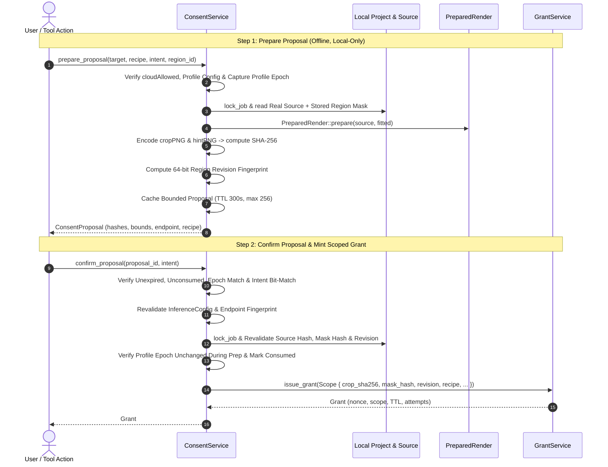

# Cloud consent and authorisation

This document covers the backend consent service: how a cloud render becomes a one-time, scope-bound grant, and the invariants that stop anything leaving the machine without one. The code is `src-tauri/src/inference/consent.rs` and `policy.rs`. The interface side is in [cloud-frontend.md](cloud-frontend.md).

---

## 1. Overview and architecture

Remote diffusion costs money and sends cropped image regions over the network. The backend therefore issues an attempt-limited [`Grant`](../src-tauri/src/inference/policy.rs), bound bit for bit to real local assets and to the user's intent.

The two-step [`ConsentService`](../src-tauri/src/inference/consent.rs) issues it:

---

## 2. Invariants

1. **No caller-supplied hashes or revisions.**
   - The caller cannot supply digests, geometry assertions or revisions.
   - Every SHA-256 digest (`source_hash`, `mask_hash`, `crop_sha256`, `hint_sha256`) and the 64-bit `revision` fingerprint is derived from disk assets under [`crate::run::lock_job`].

2. **Real local source and geometry.**
   - `prepare_proposal` loads the actual unedited source page raster and the region's mask from the project manifest (`Job`).
   - It runs [`PreparedRender::prepare`](../crates/cleaner-core/src/engines/render.rs) to compute the latent-snapped bounds (16-pixel multiples), the context padding (`CONTEXT_MIN = 24`, `CONTEXT_MAX = 80`), edge replication and the grayscale hint mask.
   - It encodes the exact RGB8 crop PNG and Gray8 hint PNG with the lossless encoder (`cleaner_core::image::encode`) and hashes them.

3. **Deterministic revision fingerprint.**
   - Pipelines without a monotonic integer counter use `compute_region_revision_hash`. It hashes the source identity, the complete serialised patch record, the mask bounds and bits, and the ink bounds and bits. It keeps the full SHA-256 and derives a 64-bit content fingerprint. Neither value is a monotonic revision counter.
   - Any change to source pixels, mask boundaries or parameters between prepare and confirm fails confirmation with [`ConsentError::RevisionMismatch`].

4. **Bounded proposal cache, no full pages in memory.**
   - `ConsentService` keeps a thread-safe in-memory cache bounded to [`MAX_CACHED_PROPOSALS`] (256 entries).
   - Proposals expire after [`DEFAULT_PROPOSAL_TTL`] (300 seconds).
   - A proposal holds only bounded metadata, SHA-256 strings, rectangles and recipes. Full page rasters ([`Raster`]) are dropped as soon as the crop and hint are extracted.

5. **Hard-bounded grant cache.**
   - `GrantService` enforces a ceiling of [`MAX_CACHED_GRANTS`] (256 entries).
   - It purges expired grants on issuance and consumption.
   - At capacity, the oldest grant by `issued_at_ms` is evicted.

6. **Profile and credential changes, coordinated with grant issuance.**
   - `GrantService` keeps profile mutation epochs and grants under one mutex, so the epoch comparison and the grant insertion happen in one critical section.
   - Changing or deleting a configuration profile (`write_inference_config`) or a credential (`store_cloud_secret`, `delete_cloud_secret`) invalidates before and after the mutation. That advances the epoch, consumes pending proposals and revokes issued grants. A malformed public configuration on disk can be replaced only after global invalidation.
   - Proposal preparation captures the epoch before raster work and rechecks it when it inserts into the proposal cache. Confirmation passes the captured epoch into atomic grant issuance. A concurrent mutation therefore either invalidates the stored proposal or grant, or returns [`ConsentError::ProfileMutated`].
   - Grant consumption and submission are coordinated in `execute_cloud_render` (`src-tauri/src/inference/service.rs`), so a successful preflight check is never treated as permission that survives a later mutation.

7. **Operation intent binding and replay prevention.**
   - A proposal binds the exact [`OperationIntent`] (`ApplyTool`, `CreateRegion`, `RerunMask`, `CleanAnyway`), including optional tool parameters and the engine parameters of `RerunMask`.
   - Confirming with a different tool name, parameters, engine or operation verb fails with [`ConsentError::IntentMismatch`].
   - Confirmation is single-use. A second attempt fails with [`ConsentError::ProposalAlreadyConsumed`].

8. **Pinned wire recipe validation.**
   - Recipes are validated with [`cleaner_core::cloud_wire::validate_recipe`].
   - That enforces ASCII identifiers, strict revision strings and the honesty check (`native_mask_conditioning = false`).
   - No placeholder or invented defaults are accepted.

9. **No network and no model warming on prepare.** Preparing a proposal is fully offline. It opens no sockets, does no DNS lookups and warms no remote container.

10. **Fail-closed region pipeline.**
    - An explicit remote target reaches the cloud only with a valid single-use grant from the consent flow. Without one, nothing is sent.
    - A re-run of a patch with cloud provenance (`record.provenance.cloud.is_some()`) never silently re-runs locally. It goes to the cloud with a grant. It runs locally only when the user names a local engine. Otherwise it fails closed with `decline.reason.rungUnavailable`, or with `notice.cloud.blocked` when cloud is off.
    - Local Flux and automatic LaMa behaviour are unchanged.

---

## 3. Limits and command surface

- **Ad-hoc new regions.** `prepare_proposal` works on stored regions (`region_id: Some(...)`). A new manual region gesture with no stored project state is refused with [`ConsentError::UnsupportedNewRegion`].
- **Registered commands.** The cloud commands are `prepare_cloud_consent`, `confirm_cloud_consent`, `submit_cloud_attempt`, `get_cloud_attempt_status`, `get_cloud_attempt_result`, `cancel_cloud_attempt`, `reconcile_cloud_recovery`, `check_cloud_connection`, `get_cloud_model_info`, `read_inference_config`, `write_inference_config`, `store_cloud_secret`, `delete_cloud_secret`, `get_cloud_secret_summary`, `run_cloud_provisioner` and `cancel_cloud_provisioner`. No fake or mock command is registered in the native app, so readiness cannot be spoofed.
- **Locking.** `run::lock_job` is an in-process lock. The cross-process attempt lock in the journal does not make project writers safe across processes.

---

See also: [cloud-security.md](cloud-security.md), [cloud-contract.md](cloud-contract.md), [cloud-journal.md](cloud-journal.md), [cloud-frontend.md](cloud-frontend.md).
