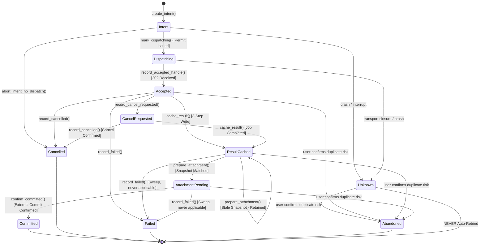

# Cloud attempt journal and result cache

This document covers the durable local record of every cloud render attempt: its state machine, locking and file layout, the validated result cache, and the recovery rules that make sure every attempt ends. The code is `src-tauri/src/inference/journal.rs`, `service.rs` and `commands.rs`.

**Protocol version:** `1.0.0`

---

## 1. System Boundary & Scope

This specification defines the bounded local transactional attempt journal, cross-process exclusive locking, atomic filesystem durability model, and validated PNG result cache implemented in `src-tauri/src/inference/journal.rs`.

The journal is the billing-safe record behind cloud dispatch. It holds the state machine, the OS-level locks, the crash recovery decision and the mandatory result decoding gate. Dispatch, polling and project attachment (`service.rs`) are built on top of it.

### Key Architectural Invariants

1. **Durable Intent Before Dispatch:** An attempt's immutable parameters and intent must be persisted and fsynced to disk before any network dispatch permit is issued to the caller.
2. **Durable Dispatching Before Request:** Phase transitions to `Dispatching` and fsyncs to disk before the caller initiates the network HTTP POST request.
3. **Crash During Intent/Dispatching Recovers as Ambiguous Unknown:** If the process terminates, loses power, or crashes while in `Intent` or `Dispatching`, recovery treats the attempt as `Unknown` unless the caller explicitly guaranteed via [`AttemptJournal::abort_intent_no_dispatch`] that no network transmission occurred.
4. **Billing Safety: Unknown NEVER Auto-Retried:** Attempts in the `Unknown` state must never be automatically retried by the system, preventing double-billing on remote GPU infrastructure. `is_auto_retryable()` always returns `false`.
5. **Accepted Handle Persisted Before Polling:** Remote handles returned by `202 Accepted` must be persisted and fsynced to disk before status polling or result fetching commences.
6. **Existing Known Handle Reusable:** Network disconnections, HTTP timeouts, or parsing errors during polling or result downloads preserve the durable remote handle for subsequent resume/retry without re-submitting a new job.
7. **Non-Terminal Cancellation Request:** `CancelRequested` remains non-terminal until remote completion or cancellation is confirmed by authoritative gateway status.
8. **Mandatory Core Decode Validation Before Caching:** Result bytes MUST pass full [`cleaner_core::cloud_decode::decode_result_crop`] validation. The journal rejects caller claims of prior validation.
9. **Three-Step Result Caching & Crash Discovery:** Caching writes validated `result_meta.json` first, `result.png` second, and updates `journal.json` to `ResultCached` third. Crash recovery from `Accepted` or `CancelRequested` reconciles pre-existing metadata and PNG via full decode verification, restoring `ResultCached` if valid, and retaining corrupted files safely for user inspection without auto-inference. The recovery sweep (section 4.4) then ends the attempt as failed with `result_corrupt` and leaves the files in place.
10. **Two-Phase Project Attachment Reconciler:** Persists `AttachmentPending` with stable `patch_id` and result identity before external project commit. Recovery verifies project state by the same `patch_id` and never blindly attaches again.
11. **Exact Snapshot Compare & Stale Attachment Rejection:** Attachment verifies exact matching across source image hash, region ID, region revision, crop hash, and hint mask hash (`ProjectRegionSnapshot`). If any field drifted, attachment fails closed (`StaleAttachment`) and `prepare_attachment` itself changes nothing. The recovery sweep (section 4.4) then ends the attempt as failed with `region_changed` and drops the cached result, so the region is not held for a result that can never be applied.
12. **Duplicate Commit Prevention:** Commits record the patch identity, ensuring idempotent re-attachment and preventing duplicate project commits.
13. **Safe Opaque Identifiers:** Identifiers are restricted to bounded ASCII alphanumeric, hyphen, and underscore characters (`[a-zA-Z0-9_-]`, 1..=128 chars) to eliminate directory traversal.
14. **Zero Secrets in Journal Storage:** The journal stores only public identifiers, hashes, and recipe parameters. No credentials, tokens, or grant nonces are ever persisted.
15. **Cross-Process Exclusive RAII Locking:** Uses OS-managed kernel file locks (`flock` on Unix, `LockFile` on Windows). Locks are released automatically on process crash without relying on stale PID guessing. Unsupported OS platforms fail closed.
16. **Guard Root Binding:** Lock guards carry and compare canonical journal roots; foreign guards from different root directories fail closed.
17. **Durability Ordering:** In-memory state never advances if disk persistence fails.
18. **Explicit Windows Durability Limitation:** This implementation does not flush directory handles on Windows; power-loss durability there remains unverified.

---

## 2. Cross-Process Exclusive Locking & Dependency Report

### 2.1 OS-Managed Kernel Locking vs Stale PID Guessing

Traditional PID file locking schemes suffer from critical edge cases:
- Process crashes leave stale PID files on disk.
- Operating system PID recycling can cause an unrelated process to appear to hold the lock.
- Reading and verifying PID files is race-prone across processes.

The journal implements kernel-managed file locking via [`AttemptLockGuard`]:
- **Unix (`cfg(unix)`):** Invokes `libc::flock(fd, libc::LOCK_EX | libc::LOCK_NB)`.
- **Windows (`cfg(windows)`):** Invokes `windows_sys::Win32::Storage::FileSystem::LockFile(handle, 0, 0, 1, 0)`.
- **Automatic Kernel Cleanup:** When a process terminates (normally or abnormally via SIGKILL, crash, or panic), the operating system kernel automatically closes all open file descriptors and handles, immediately releasing the lock. No stale lock cleanup logic is required.
- **Rust MSRV 1.82 Compliance:** Avoids newer unstable `std::fs::File::lock` APIs.
- **Foreign Guard Prevention:** Guards store the canonical path of the issuing journal root. Any locked mutation or read checks `guard.canonical_root == self.canonical_root`, preventing cross-journal corruption.

### 2.2 Dependencies

The module uses the `libc` and `windows-sys` crates. No `fs2` dependency is needed. Tests run on macOS; Windows locking and power-loss behaviour remain unverified.


## 3. Filesystem Layout & Atomic Durability Semantics

### 3.1 Directory Structure

The journal root resides in an application-owned directory (e.g. `<app_data_dir>/cloud_journal/`):

```text
<journal_root>/
└── attempts/
    └── <attempt_id>/
        ├── lock               # Zero-byte file for OS-level exclusive locking
        ├── journal.json       # Atomically written state machine record
        ├── result_meta.json   # Step 1: validated result metadata
        └── result.png         # Step 2: validated output crop PNG
```

### 3.2 Atomic Write & Fsync Ordering

All mutations to `journal.json`, `result_meta.json`, and `result.png` execute via `atomic_write_file`:
1. Generate a unique sibling temporary file in the same parent directory: `.<name>.tmp.<pid>_<nanos>_<counter>`.
2. Open with `create_new(true)` to guarantee no collision.
3. Write payload bytes and invoke `file.sync_all()`.
4. Close/drop the file handle before renaming (mandatory for Windows compatibility).
5. Atomically rename the temporary file over the target path (`fs::rename`).
6. **Unix Parent Directory Sync:** On Unix platforms, open the parent directory and invoke `dir.sync_all()`, propagating any I/O errors.
7. **Explicit Windows Durability Limitation:** This implementation does not flush Windows directory handles. Windows power-loss and installed-package tests remain required; no NTFS durability guarantee is claimed.

### 3.3 Streaming Reads & Denial of Unknown Fields

- Reading `journal.json` and `result_meta.json` uses streaming reads bounded at `MAX_JOURNAL_JSON_BYTES + 1` (`take(MAX_JOURNAL_JSON_BYTES + 1)`), rejecting oversized payloads during stream consumption rather than relying on file metadata alone.
- `AttemptRecord`, `AttemptPhase`, and `ProjectRegionSnapshot` enforce `#[serde(deny_unknown_fields)]`.
- `get_record` executes full semantic validation on schema version, IDs, hashes, recipe metadata, dimensions, canonical request digest, and phase constraints.

---

## 4. State Machine & Lifecycle Transitions

### 4.1 Lifecycle State Machine



### 4.2 Phase Transitions Table

| Current Phase | Action / Method | Target Phase | Invariants & Requirements |
|---|---|---|---|
| *None* | `create_intent` | `Intent` | Validates IDs, bounds, dimensions (`LATENT_STRIDE=16`), and `MC-REQ-V1` digest. Acquires exclusive lock. Persisted before permit. |
| `Intent` | `mark_dispatching` | `Dispatching` | Fsyncs to disk before returning `DispatchPermit`. In-memory state does not advance if disk write fails. |
| `Intent` | `abort_intent_no_dispatch` | `Cancelled` | Caller explicitly guarantees no HTTP request was sent. Recovers as terminal cancelled. |
| `Intent` | *Crash / Restart* | `Unknown` | Ambiguous whether dispatch began; marked `Unknown`. Never auto-retried. |
| `Dispatching` | `record_accepted_handle` | `Accepted` | Stores remote `handle` (e.g. `handle-test-modal-999`). Must be durable before polling starts. |
| `Dispatching` | `record_dispatch_transport_error` | `Unknown` | Network disconnects before `202 Accepted`. Status ambiguous; never auto-retried. |
| `Dispatching` | *Crash / Restart* | `Unknown` | Process interrupted while request was in-flight. Remote execution unknown; never auto-retried. |
| `Accepted` | `record_cancel_requested` | `CancelRequested` | Non-terminal request. Allows subsequent completion or cancellation. |
| `Accepted` / `CancelRequested` | `cache_result` | `ResultCached` | 3-step write: writes `result_meta.json`, then `result.png`, then updates `journal.json` to `ResultCached`. Mandatory `decode_result_crop` validation. |
| `Accepted` / `CancelRequested` | `record_cancelled` | `Cancelled` | Authoritative remote gateway confirmed cancellation. Terminal. |
| `Accepted` / `CancelRequested` | `record_failed` | `Failed` | Authoritative remote gateway reported worker failure, no longer knows the job, or its endpoint is no longer configured. The gateway's own `error_code` and `message` are stored (`record_remote_failure`), as a lowercase code of at most 64 characters and one line of at most 300. Non-retryable. |
| `ResultCached` / `AttachmentPending` | `record_failed` | `Failed` | The recovery sweep found that the result can never be applied (section 4.4). `drop_cached_result` then removes `result.png` and `result_meta.json`, except for a damaged result, which is kept. |
| `ResultCached` | `prepare_attachment` | `AttachmentPending` | Verifies full snapshot (`source_image_hash`, `region_id`, `region_revision`, `crop_sha256`, `hint_sha256`). Persists stable `patch_id` and result identity before external project commit. |
| `ResultCached` | `prepare_attachment` | `ResultCached` | Snapshot mismatch. Returns `StaleAttachment` error and changes nothing. The sweep ends the attempt (the row above). |
| `AttachmentPending` | `confirm_committed` | `Committed` | Confirms receipt from external project commit. Commits record `patch_id` to guarantee idempotent commits. |
| `Unknown`, `Accepted`, `CancelRequested`, `ResultCached`, `AttachmentPending` | `abandon` | `Abandoned` | The user confirmed the duplicate-cost warning (section 4.6). The phase keeps the previous phase and the confirmation timestamp. Terminal. |

### 4.3 Recovery Decision Tree (`recover_attempt`)

Upon application restart, the journal inspects uncommitted attempts and returns explicit recovery decisions:

- **`Intent` or `Dispatching`:** Transitions to `Unknown` and returns `RecoveryDecision::AmbiguousUnknown`. **NEVER auto-retried.**
- **`Accepted` or `CancelRequested` (with result files on disk):** Discovers `result_meta.json` and `result.png`. Runs full core `decode_result_crop` validation. If valid, restores `ResultCached` and returns `RecoveryDecision::ResultCachedReadyForAttach`. If corrupt, retains files for inspection and returns `RecoveryDecision::CorruptedResultRetainedForInspection`.
- **`Accepted` (no result files):** Returns `RecoveryDecision::ResumePolling { handle }`. Reuses existing known handle without re-submitting.
- **`CancelRequested` (no result files):** Returns `RecoveryDecision::ResumeCancelPolling { handle }`. Resumes polling to observe completion or cancellation.
- **`ResultCached`:** Returns `RecoveryDecision::ResultCachedReadyForAttach { handle, result_digest }`. Reuses locally validated output.
- **`AttachmentPending`:** Returns `RecoveryDecision::AttachmentPendingVerification { patch_id, result_digest }`. Caller must query the local project database by `patch_id` to verify if commit completed before crash, preventing duplicate project attachment.
- **`Committed`:** Returns `RecoveryDecision::AlreadyCommitted { patch_id }`. No action required.
- **`Cancelled` or `Failed`:** Returns `RecoveryDecision::Terminal { message }`. Never auto-retried.

### 4.4 The recovery sweep: every request ends

`recover_attempt` only names a decision. The sweep acts on it (`sweep_attempts` in `commands.rs`,
`recover_attempt_with_snapshot` and `recover_cloud_attempt` in `service.rs`). The rule: an attempt
that has not ended holds its region, so every attempt must end. The plan of a cloud clean leaves
out a region with an unresolved attempt, and a new request for it is refused
(`recovery_required`). That is right while a request is in flight and wrong for one that will
never finish.

| Phase found | The sweep does |
| --- | --- |
| `accepted` or `cancel_requested`, not live in this process | Asks the gateway, in the background. Completed: downloads the result and goes on to the next row. Failed: records failed with the gateway's code and message. Cancelled: records cancelled. Unknown to the gateway (HTTP 404 for the job on three polls in a row): records failed with `remote_job_not_found`. Endpoint no longer configured: records failed with `profile_removed`. Still pending or running when the wait ends (15 minutes): stays accepted for the next sweep |
| `result_cached` | Goes on to attach. A result is applied at once, so none waits for a person: no render and no sweep asks about a result, a Qwen result included |
| `attachment_pending` | Tries the attach once. Region, page or chapter changed or gone: records failed with `region_changed` and drops the cached result |
| `unknown` (the submission may or may not have arrived) | Stays the one case the user decides. It is reported as `ambiguous`, looked up at the gateway, never resent and never ended by the sweep. A double render is a real cost |

Details the table does not say:

- **A dismissed notice.** Dismissing writes `repair-acknowledged.json`. The report then forgets
  the attempt, and the sweep does not. A dismissal must never keep an unended attempt out of the
  sweep, because that would hold its region for good.
- **A chapter that is gone.** An attempt whose chapter is no longer in the library ends as
  `region_changed`, whether it holds a result or is still accepted. Nothing is downloaded for it.
- **A damaged result.** A cached result that fails validation, or whose file is missing, ends its
  attempt as `result_corrupt`. The files that are there are kept.
- **A chapter that cannot be read now.** A manifest or source image that cannot be read ends
  nothing. The attempt is reported as `load_error` and waits, with its result, for the next sweep.
- **No library, no sweep.** The app reads the library index once before the sweep and does not
  sweep when that read fails. A failed read must never look like a deleted chapter.
- **A render the user is watching** is not a recovery. A 404 for a job just accepted does not end
  it; only a wait that resumes an old attempt applies that rule.
- **The report.** `attached`, `stillRunning`, `needsAttention`, and `released`: the attempts this
  sweep ended with nothing applied. Their regions are ordinary detected regions again.

The sweep runs at start (when cloud is allowed, or the first time it is allowed), with an audit of
the results already applied. It runs again before a cloud clean is prepared
(`prepare_cloud_clean`), without that audit, so the plan leaves a region out only for a request
that is in flight or unknown.

### 4.5 The seed of a retry

A first attempt for a region carries the recipe's seed. A retry adds to it, so the retry is a new
render and not the same image again. The amount is `sent_attempts` times the recipe's step: the
count of earlier attempts for the same chapter, page and region that were sent or may have been.
An attempt that certainly never left (`Cancelled` with no handle) is not counted. The step is 1,
and 3 for the Qwen recipe, whose worker renders three seeds in a row from the one it is sent. The
seed is added where the request is built (`dispatch_and_attach`), and each record keeps the seed
that was sent. A gateway takes a later seed only when its capabilities list `jobs.retry_seed`; an
older one refuses any seed but the recipe's and is sent the recipe's.

### 4.6 Lookups, abandon and audits

**Recovery never uploads images.** Cached results keep their original input and predecessor bindings. Startup audits committed entries against the manifest's patch identities and buffers. A missing patch or a changed input requests repair and keeps the journals, result PNGs and revision buffers. New intents are serialised by region and refused while another attempt for the same chapter, page and region is unresolved, even if a fresh grant was issued.

**Pre-send failures.** A proven pre-send failure, or an identity-bound `enqueued: false` rejection, closes the attempt as Cancelled without a handle. A fresh consent grant may then retry that region. Only transport failures that could hide acceptance become Unknown. Recovery lookups ([cloud-contract.md](cloud-contract.md) section 6) and accepted-job waits run independently in background recovery workers.

**Abandon.** Cloud settings offers recovery on demand and an explicit Abandon action for stuck attempts. `reconcileCloudRecovery({action: "abandon", attemptId, acceptDuplicateRisk: true})` records an Abandoned phase. The confirmation warns that a remote job may still complete and that a later render may duplicate paid work. No remote cancellation and no replacement `POST` is implied. All evidence stays on disk.

**Scope index.** A durable index tracks unresolved attempts, with one migration scan for old journals. An unreadable journal blocks only its own chapter, page and region scope. Library load failures are load errors.

**Commit audit.** Committed audits cache a marker keyed by manifest, undo history and source file metadata. Source hashing is shared per chapter snapshot, outside the chapter writer lock. A commit is superseded by a changed region revision, a recorded undo or replacement, a deleted region or a deleted chapter. It is also superseded by a result the user rejected or undid: that patch is set aside in the manifest's `withdrawn_patches` with the attempt's id, which the audit reads whether or not the undo journal still holds the step. A plain predecessor detection at its original revision with no recorded action and no withdrawn patch still requests repair.

**Dismissing a repair** writes `repair-acknowledged.json`. It never deletes journal, result or revision evidence, and it does not keep an unended attempt out of the recovery sweep (section 4.4).

---

## 5. Tests

The journal module has unit tests that exercise real filesystem paths, locks and PNG decoding:

1. `test_safe_opaque_id_validation`: Path traversal sequences, null bytes, whitespace, and empty/oversized IDs fail closed.
2. `test_foreign_guard_rejected`: Guard acquired from journal A used against journal B fails closed with `ForeignGuard`.
3. `test_ambiguous_accept_disconnect_counted`: Transport drop during dispatch transitions to `Unknown` and enforces zero auto-retry.
4. `test_abort_intent_explicit_no_dispatch`: Explicit pre-dispatch abort recovers as terminal cancelled, not ambiguous unknown.
5. `test_restart_known_handle_and_result_reuse`: Crash recovery resumes polling with the existing known handle, and subsequently reuses cached validated PNGs across restarts.
6. `test_invalid_lifecycle_transitions`: Illegal transitions (premature accept, caching without acceptance) fail closed.
7. `test_disk_write_failure_injection_preserves_in_memory_state`: Simulated write failures preserve disk and in-memory state in `Intent`.
8. `test_concurrent_ownership_two_lock_descriptors`: Cross-process mutual exclusion verifies second descriptor fails with `AttemptLocked` and succeeds upon guard drop.
9. `test_cancellation_ack_nonterminal`: Proves non-terminal state allows subsequent completed or cancelled resolution.
10. `test_two_phase_project_commit_and_recovery`: Proves `AttachmentPending` persistence before commit, restart recovery requiring project check, and idempotent commit receipt.
11. `test_wrong_source_same_revision_stale_attach`: Snapshot with matching revision but mismatched image hash fails closed with `StaleAttachment` and retains cached output.
12. `test_corrupt_cache_read_rejected`: Tampered cached PNG bytes fail hash and decode checks in `read_cached_png`.
13. `test_crash_between_result_write_and_journal_recovers`: Simulates process crash after metadata and PNG write; recovery discovers files, decodes them, and restores `ResultCached`.
14. `test_no_auto_retry_accepted_failure`: Verifies that failures are strictly non-retryable and `is_auto_retryable()` returns false.
15. `a_failure_keeps_the_gateways_code_and_message`: A failure's code and message are read back from disk as the gateway sent them.
16. `a_stored_failure_reason_is_a_bounded_code_and_one_line`: Anything that is not a short lowercase code is stored as `remote_failure`, and a message is cut to one line of 300 characters.
17. `only_attempts_that_may_have_rendered_count_as_sent`: The count behind the retry seed leaves out an attempt that never left and another region's attempts.

The sweep's rows are tested in `service.rs`, one test per row of the table in 4.4
(`sweep_attaches_a_cached_result_or_ends_one_whose_region_changed`,
`sweep_tries_a_pending_attach_once_and_ends_one_whose_region_changed`,
`sweep_ends_an_accepted_job_the_gateway_failed_or_no_longer_knows`,
`sweep_leaves_an_unknown_submission_to_the_user`), with the dismissed notice, the missing chapter,
the damaged result and the unreadable chapter beside them. The seed is tested by
`a_retry_of_a_region_carries_a_new_seed_and_a_first_attempt_the_base_seed`, and the plan by
`a_region_whose_attempt_the_sweep_ended_is_planned_by_the_next_prepare` in `cloud_clean/tests.rs`.

### Further rules

- New directory entries and parent directories are synced on Unix, with errors propagated.
- Cache reads use a 64 MiB host ceiling, independent of advertised limits.
- Resuming the same pending patch rechecks all snapshot fields and cached pixels.
- Transition diagnostics are static strings. Raw HTTP, body and store errors are not accepted for persistence. The one exception is a failed job's typed error from the gateway: its code and message are stored, bounded as the transition table says.
- The external project writer must verify the stable patch ID before it calls `confirm_committed`. This module neither performs nor certifies a project commit.

---

See also: [cloud-contract.md](cloud-contract.md), [cloud-consent.md](cloud-consent.md), [cloud-security.md](cloud-security.md), [cloud-transport.md](cloud-transport.md), [cloud-frontend.md](cloud-frontend.md).
